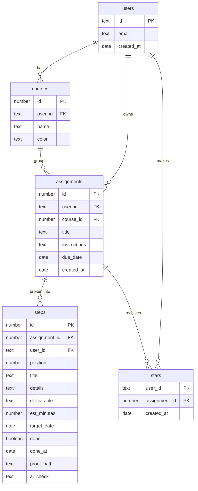

# Focus Lock: Project Plan

## 1. Pitch

I'm building **Focus Lock** because neurodivergent people, including me, often know what needs
doing but struggle to break a big task into steps and actually start. Focus Lock uses Claude to
turn an assignment into small, dated steps, checks uploaded work to confirm each step is really
done, and locks me out of distractions when I fall behind the plan.

**How often I'll use it:** daily. Every assignment I get this semester goes in on the day it's
assigned, and I check in whenever a step comes due.

## 2. Features

Numbered in the order I'll build them. Features 1-7 are the required spine; 8-10 are mine.

1. **Sign up and login.** As a student, I want to create my own account and log in and out, so
   that my assignments and steps stay private to me.
2. **Data model.** As a student, I want my assignments grouped by course, each with its own list
   of steps, so that all my coursework lives in one organized place.
3. **Create, read, update, delete.** As a student, I want to add an assignment with a title,
   course, due date and pasted instructions, see my list, open one assignment's page, edit it,
   and delete it after an "Are you sure?" check, so that the app always matches my real workload.
4. **Validation.** As a student, I want a friendly message when I leave the title, course or due
   date blank, so that I never save an assignment that can't be planned.
5. **Stars.** As a student, I want to star my highest-priority assignments and see them in a
   Starred view, so that I know what to focus on first.
6. **Find things.** As a student, I want to search by keyword, filter by course and status, and
   sort by due date or newest, so that I can find any assignment in seconds.
7. **Dashboard.** As a student, I want to see my on-time rate, steps completed this week and hours
   planned for the next 7 days, plus a chart of steps completed per week, so that I can tell
   whether I'm keeping up.
8. **AI breakdown.** As a student who struggles to start big tasks, I want to paste an
   assignment's instructions and get back small, dated steps (the first one 15 minutes or less,
   none over 90 minutes, the last one at least 2 days before the deadline), each with a concrete
   deliverable, that I can edit before saving, so that I always know the next small thing to do.
9. **Proof upload.** As a student, I want to upload a PDF, image or text for a step and have
   Claude check it against that step's deliverable, so that a step only counts as done when the
   work actually exists.
10. **Lockout.** As a student who gets distracted, I want the app to switch into a locked state
    when a step is overdue, showing only what I need to upload, and, as a stretch goal, a script
    on my Mac that blocks distracting websites until I upload proof, so that ignoring the plan has
    a real consequence.

## 3. Database

| Table | Columns (type) | Primary key |
| --- | --- | --- |
| users | id (text), email (text), created_at (date) | id (same as the Supabase login id) |
| courses | id (number), user_id (text), name (text), color (text) | id |
| assignments | id (number), user_id (text), course_id (number), title (text), instructions (text), due_date (date), created_at (date) | id |
| steps | id (number), assignment_id (number), user_id (text), position (number), title (text), details (text), deliverable (text), est_minutes (number), target_date (date), done (true/false), done_at (date), proof_path (text), ai_check (text) | id |
| stars | user_id (text), assignment_id (number), created_at (date) | the pair (user_id, assignment_id) |

**How the tables connect**

- One user has many courses, assignments and steps (one-to-many).
- One course has many assignments (one-to-many).
- One assignment has many steps (one-to-many). Deleting an assignment deletes its steps.
- Users and assignments are connected many-to-many through `stars`: each row means "this user
  starred this assignment." One table for everyone.
- Every table has row-level security, so a user can only read and change their own rows.

## 4. Tests

1. **Data isolation.** Given User A has an assignment and User B has none, when User B loads
   their assignment list or asks for User A's assignment by its id, then User B gets an empty list
   and no assignment back.
2. **Dashboard.** Given four completed steps, two finished before their target date, one on its
   target date and one late, when the dashboard calculates the on-time rate, then it shows 75%.

## 5. Technologies

| What | Choice | Why |
| --- | --- | --- |
| Coding agent | Claude Code | It runs git and GitHub commands itself, so each issue, branch and PR is one prompt. |
| Framework | Next.js with Tailwind | Pages and server code live in one project, and Tailwind makes a consistent look quick. |
| Database | Supabase (Postgres) | A real relational database with row-level security, which enforces data isolation in the database itself. |
| Sign up and login | Supabase Auth, email and password | Built into the same service as the database, so each login maps directly to a row in `users`. |
| File storage | Supabase Storage | Keeps proof uploads private per user, next to the data that references them. |
| Hosting | Vercel | Redeploys automatically on every merge to main, so the live URL is always current. |
| AI | Claude API (claude-sonnet-5-5) | Breaks assignments into steps and checks uploaded proof against each deliverable. |
| Chart | Recharts | A simple React chart library for the dashboard's weekly chart. |
| Tests | Vitest | Fast, simple tests that run with one command. |
| Laptop lock (stretch) | SelfControl on macOS | Free, and its blocks can't be undone early, which is the point. |

## 6. Design

Clean but warm: friendly rather than corporate.

- **Colors:** purple and white. Primary purple `#6B4EFF` for buttons and highlights, deep purple
  `#3D2A8C` for headings, light lavender `#F4F1FF` for backgrounds and cards, white for the main
  surface, and a soft red `#E5484D` reserved for overdue and locked states.
- **Style:** rounded corners, generous white space, one clear action per screen, a rounded
  friendly font (Nunito), and short, encouraging copy.
- **Inspiration:** Things 3 for its clean, calm task lists, and Finch for its friendly,
  non-judgmental tone.

## 7. Risks and cuts

- **Least sure I can build:** the laptop lock. It needs a background script with administrator
  rights on macOS, and a SelfControl block can't be stopped early, so a bug could lock me out.
- **Cut first if I run out of time:** the laptop lock. The in-app locked state stays, so feature 10
  still works on the live URL.
- **Cut second:** Claude's proof check. Uploading a file would simply mark the step done.
